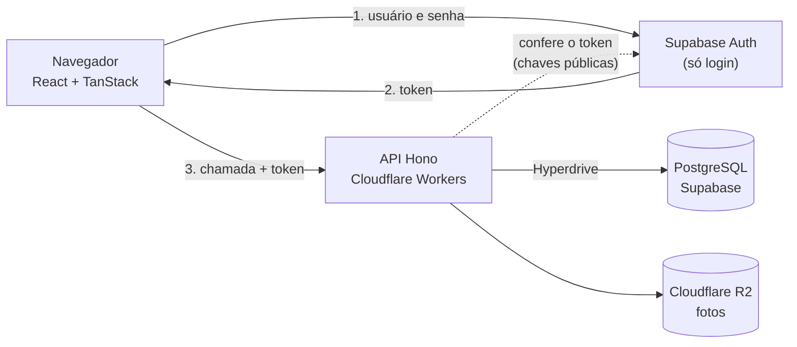
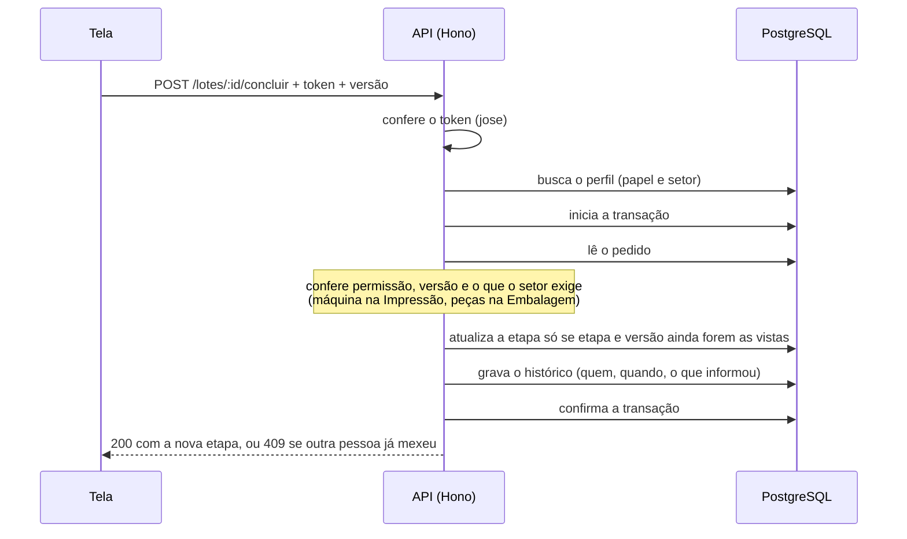

# PCP MA · Tecnologias

Documentação das tecnologias do PCP MA (controle de produção da MA Fardamentos): o que cada uma faz, por que foi escolhida, como se encaixa no código e o que ainda está em aberto.

- **Estado:** prova de conceito. Código e testes locais prontos; a API já está publicada e medida contra um Supabase e um Hyperdrive reais (26/10/2026). Ainda sem R2 (fotos) e sem a chave de administrador no Worker.
- **Última conferência de versões e planos:** 23/10/2026.
- **Requisitos e regras de negócio:** [documento no claude.ai](https://claude.ai/artifact/EJc3eY1PQqkYAaxm3gLuwc) (não repetido aqui). As regras citadas como RN-xx e RF-xx vêm dele.

## 1. Visão geral

O navegador mostra as telas (React). Cada pessoa entra com usuário e senha no **Supabase Auth**, que devolve um token. A tela manda o token para a **API** (Hono, nos Workers da Cloudflare). A API confere o token, descobre o papel e o setor da pessoa numa tabela do banco, aplica as regras e fala com o **PostgreSQL do Supabase** pelo **Hyperdrive**. Fotos e comprovantes irão para o **Cloudflare R2**, sempre por dentro da API.

Princípio central: **só a API decide o que cada pessoa pode fazer.** O navegador nunca fala com o banco.



## 2. Resumo da stack

| Camada | Tecnologia | Versão no projeto | Papel | Estado |
|---|---|---|---|---|
| Interface | Vite + React + TypeScript | Vite 8.3, React 19.3, TypeScript 5.9 | Telas de login, fila do setor e orçamento | Em uso |
| Rotas | TanStack Router | 1.170 | Navegação e proteção das áreas | Em uso |
| Dados da tela | TanStack Query | 5.104 | Busca e atualização da fila (a cada 20 s) | Em uso |
| Validação e regras | Zod + pacote `@pcp/shared` | Zod 4.6 | Mesmas regras na tela e na API | Em uso |
| API | Hono | 4.13 | Autenticação, permissões e movimentação dos pedidos | Em uso |
| Execução da API | Cloudflare Workers + Wrangler | Wrangler 4.152 | Hospedagem da API | Em uso (local) |
| Conexão com o banco | postgres.js + Hyperdrive | postgres 3.4.9 | Pool de conexões até o Postgres | Em uso (sem teste real) |
| Banco de dados | PostgreSQL no Supabase | — | Pedidos, histórico e perfis | Em uso (esquema pronto) |
| Login | Supabase Auth + biblioteca `jose` | supabase-js 2.118, jose 6.2 | Confirma quem é a pessoa | Em uso |
| Arquivos | Cloudflare R2 | — | Fotos de referência (comprovantes na Etapa 2) | Em uso (código pronto; o R2 de verdade não foi verificado) |
| Testes | Vitest + PGlite | Vitest 5.0, PGlite 0.5 | 171 testes (60 de regras e 111 da API), com Postgres, armazenamento e login de mentira em memória | Em uso |
| Organização | npm workspaces | npm 11 | `packages/shared`, `apps/api`, `apps/web` | Em uso |
| Hospedagem da interface | Cloudflare | — | Publicar o front | **Decidido, não configurado** |

Fora da stack, por decisão: NestJS, Render, Clerk, Better Auth, Supabase Storage, a API automática do Supabase, TanStack Table e TanStack Form.

## 3. Estrutura do projeto

```
pcp-ma/
├─ packages/shared/   regras compartilhadas: rota dos setores, preço, prazo, esquemas Zod (+ testes)
├─ apps/api/          Hono: autenticação, fila, clientes, pedidos, ficha, fotos, usuários, concluir e devolver (+ testes com PGlite)
│                      dev-local.ts: servidor local com dados de exemplo, sem Supabase
├─ apps/web/          React: login, fila do setor, ficha, concluir e devolver, novo pedido em 4 passos, orçamento para imprimir
├─ db/                schema.sql, seed.sql e seed-medicao.sql
├─ scripts/medir.mjs  mede o tempo da API de ponta a ponta
└─ docs/              REFERENCIA.md (requisitos, regras, estado) e esta documentação
```

## 4. Como as peças conversam

### Contrato da API

| Rota | Quem acessa | O que faz |
|---|---|---|
| `GET /health` | Qualquer um | Responde `{"ok":true}` |
| `GET /me` | Logado, com perfil ativo | Devolve nome, papel e setor, lidos do banco |
| `GET /fila` | Logado, com perfil ativo | Setor: só os pedidos da sua etapa. Atendimento, direção e admin: todas as etapas em aberto, com total e recebido (o setor nunca). Ordem: prioridade, entrega, número. Pedido em recuperação traz o motivo da devolução (`motivoRecuperacao`). `?aba=concluidos` (só atendimento, direção e admin): os 50 concluídos mais recentes |
| `GET /clientes?q=` | Atendimento, direção, admin (setor: 403) | Busca por nome, documento ou cidade (até 20). `%` e `_` na busca são texto |
| `POST /clientes` | Atendimento, admin | Cadastra o cliente. Nome com pelo menos 3 letras; documento repetido: 409 com o nome de quem já tem |
| `POST /pedidos` | Atendimento, admin | Abre o pedido (Cliente ou Feira), soma as grades, copia o nome do cliente para `descricao`, grava o histórico e envia ao Design, tudo numa transação. Valida RN-03, 04, 05, 13 e 14. Resposta 201 com `id` e `numero` |
| `GET /lotes/:id` | Setor (só pedido do seu setor), atendimento, direção, admin | Ficha: produtos com grade, especificações e linha do tempo (quem, quando, o que informou). O objeto `cliente` (documento, telefone) só vai para atendimento, direção e admin |
| `POST /lotes/:id/fotos` | Atendimento, admin | O corpo é a imagem; nome em `X-Nome` (codificado como URL). Aceita JPEG, PNG e WebP pelos bytes do arquivo, até 2 MB e 6 por pedido. Erros: 413 grande demais, 415 tipo não aceito, 409 limite |
| `GET /fotos/:id` | Setor (só fotos de pedidos do seu setor), atendimento, direção, admin | Devolve a imagem com `nosniff` e cache privado. A foto nunca tem endereço público |
| `GET /usuarios` | Admin | Lista os usuários (ativos primeiro) |
| `POST /usuarios` | Admin | Cria o login no Supabase Auth e o perfil. Desfaz o login se o perfil não puder ser gravado. E-mail repetido: 409 |
| `POST /usuarios/:id/ativo` | Admin | Ativa ou desativa o acesso, sem apagar nada. O admin não desativa a si mesmo (409) |
| `POST /usuarios/:id/senha` | Admin | Define uma nova senha (D13) |
| `POST /usuarios/:id/precos` | Admin | Dá ou tira (`gerenciaPrecos`) a permissão de gerenciar preços. Só vale para o Atendimento (400 para os outros); o banco também recusa |
| `GET /catalogo` | Atendimento, direção e admin | Os produtos ativos com a malha e os dois preços por peça, em centavos. Setor: 403 |
| `GET /precos` | Admin, direção e Atendimento com permissão | Todos os produtos, ativos e desativados, com os dois preços, a data e quem alterou por último. Os outros: 403 |
| `POST /precos` | Admin, direção e Atendimento com permissão | Cria um produto (nome e malha em maiúsculas; 409 se o nome já existe) |
| `POST /precos/:id` | Admin, direção e Atendimento com permissão | Altera nome, malha, preços e se está ativo. A escrita é por POST porque o CORS da API só libera GET e POST |
| `GET /lotes/:id/orcamento` | Atendimento, direção e admin (setor: 403) | Dados do orçamento de um pedido de Cliente (cliente, itens com o preço do dia, total, recebimentos, saldo). Feira: 400 |
| `GET /quadro` | Direção e admin | Quadro só de leitura: 6 indicadores, colunas por setor (mais Financeiro e Concluídos hoje), pedidos que pedem atenção (atrasados e recuperações) e totais em centavos. Montado por `montarQuadro` (`packages/shared`). Outros perfis: 403 |
| `GET /financeiro` | Atendimento, direção e admin | Recebido hoje, 7 dias e mês, total a receber, e os pedidos de Cliente em Financeiro com total, recebido, saldo, percentual e recebimentos. Setor: 403. Registrar recebimento e confirmar entrega: atendimento, direção e admin |
| `POST /lotes/:id/recebimentos` | Atendimento, direção e admin | Corpo: `versao`, `valorCentavos`, `forma` (Pix, Dinheiro, Cartão, Boleto, Transferência). Só com o pedido em Financeiro; valor dentro do saldo (400); versão velha ou clique repetido: 409 |
| `POST /lotes/:id/entregar` | Atendimento, direção e admin | Corpo: `versao`. Só com saldo zero (400 com o saldo); conclui o pedido |
| `POST` e `GET /recebimentos/:id/comprovante` | Atendimento, direção e admin | O corpo é o arquivo (imagem JPEG/PNG/WebP ou PDF, até 5 MB; tipo pelos bytes; nome em `X-Nome`). Um comprovante por recebimento (409 se repetir). Precisa do R2 |
| `POST /pedidos` | Atendimento e admin | Cada produto tem de estar no catálogo (sem diferenciar maiúsculas) e a grade tem de combinar (infantil ou adulta). A API calcula o preço e o total (ignora qualquer total da tela) e confere a entrada contra o total. Aceita `entrada` (`valorCentavos`, `forma`); devolve `entradaId` e `totalCentavos` da entrada |
| `POST /lotes/:id/devolver` | Laser ou Conferência com o pedido na sua etapa; admin nessas etapas | Corpo: `versao` e `motivo` (pelo menos 3 letras). Volta ao Design como recuperação, com histórico. Outras etapas: 403; já devolvido ou versão antiga: 409 |
| `POST /lotes/:id/concluir` | Setor da etapa atual ou admin | Corpo: `versao` (obrigatório), `maquina`, `pecas`, `nota`. `maquina` só é gravada na Impressão e `pecas` só na Embalagem; nas outras etapas são ignoradas. Respostas: 200, 400 (com a lista de campos inválidos), 401, 403, 404 e 409 |

A API também devolve o tempo gasto no banco no cabeçalho `Server-Timing`, usado pelo script de medição.

### Concluir uma etapa



Se duas pessoas (ou dois cliques) tentam concluir o mesmo pedido, só a primeira vale; a segunda recebe 409. Se o pedido já passou pelo setor da pessoa, a resposta também é 409, e não 403.

## 5. Tecnologias, uma a uma

### React, Vite e TypeScript
- **O que faz:** monta as telas. Vite serve o desenvolvimento e gera o pacote final; TypeScript checa os tipos.
- **Por que:** combinação comum, rápida e adequada a um sistema de poucos usuários.
- **No projeto:** `apps/web`. As telas são cartões e formulários simples, pensadas para celular (botões de pelo menos 44 px, janela que sobe de baixo).

### TanStack Router e Query
- **Router:** define `/login`, `/fila` e `/orcamento`. Quem não está logado é mandado para o login antes de a área abrir.
- **Query:** busca `/me` e `/fila`, reconsulta a fila a cada 20 s e quando a pessoa volta para a aba, e atualiza a lista depois de concluir. Tempo real fica para depois, se fizer falta.
- **Não usados por ora:** TanStack Table e TanStack Form, porque as telas atuais não precisam deles.

### Zod e o pacote `@pcp/shared`
- **O que faz:** guarda as regras que precisam ser iguais na tela e na API: ordem dos setores (com e sem bordado), o que cada setor informa, cálculo de preço por faixa (10 peças ou mais), leitura de valores no formato brasileiro, dia em Fortaleza e semáforo de prazo. Valores em centavos, para não acumular erro de arredondamento.
- **No projeto:** `packages/shared/src`, com 26 testes. Zod 4 (a versão 3 tinha um alerta alto de consumo de memória em 23/10/2026).

### Hono nos Cloudflare Workers
- **O que faz:** é a API. Confere o token, carrega o perfil, aplica as regras e responde em JSON.
- **Por que no Workers:** ficar na mesma Cloudflare da interface e dispensar um servidor.
- **Cuidados:**
  - O plano gratuito dos Workers limita a **10 ms de CPU por requisição**; o pago permite 30 s por padrão. Conferir o login e responder pode estourar o limite do gratuito (erro 1102). Para uso diário, usar o plano pago.
  - Por enquanto a API **não guarda segredos**: ela só confere o token com as chaves públicas do Supabase, e a senha do banco fica na configuração do Hyperdrive. Quando o administrador puder criar usuários pela tela (RF-04), a API vai precisar da chave `service_role` do Supabase, guardada como segredo do Worker (`wrangler secret put`), nunca no código nem no navegador.
  - Rotas de dados exigem token e perfil ativo. Erros 500 não expõem detalhes.

### Hyperdrive e postgres.js
- **O que faz:** o Hyperdrive mantém um pool de conexões entre os Workers e o banco; o postgres.js é o cliente.
- **No projeto:** um cliente novo a cada requisição, com no máximo 5 conexões e prepared statements **ligados** (a Cloudflare recomenda assim; desligar pode travar consultas). `apps/api/src/db.ts`.
- **Conexão:** a "Direct connection" do Supabase é só IPv6 sem o add-on de IPv4. O projeto usa a **Session pooler** (`aws-1-sa-east-1.pooler.supabase.com`, porta 5432, usuário `postgres.<ref>`), criada com `scripts/criar-hyperdrive.ps1`. O Hyperdrive é criado com **cache desligado** (`--caching-disabled`): por padrão ele guarda respostas de leitura, e a fila precisa refletir cada conclusão na hora.
- **Verificado (26/10/2026):** o postgres.js com prepared statements funciona atrás do Hyperdrive real, e o login do Supabase (ES256, JWKS) é aceito. Não dá para testar o Hyperdrive com `wrangler dev` (o vínculo remoto falha com "TLS handshake failed"); o teste é com a API publicada. Medição, Worker em `workers.dev`, banco em São Paulo, `scripts/medir.mjs`: leitura da fila mediana 137 ms (banco 17 ms); concluir etapa mediana 155 ms, p95 240 ms (banco 48 ms). A primeira chamada fria levou 873 ms. Falta medir uma segunda região (EUA) para comparar.

### PostgreSQL no Supabase
- **Tabelas:** `perfis` (papel e setor de cada pessoa), `clientes` (dados pessoais; só atendimento, direção e admin), `lotes` (pedido, etapa, versão), `itens_pedido` (produtos e grade de cada pedido), `fotos` (dados de cada foto; o arquivo fica no R2) e `historico` (quem fez cada etapa).
- **Segurança do banco:** RLS ligado em todas as tabelas, sem nenhuma política e sem permissão para `anon` e `authenticated`. A chave pública do Supabase, que vai no navegador, não lê nem grava nada. A API entra pela conexão do Hyperdrive.
- **Versão do pedido:** a coluna `versao` sobe a cada movimentação e protege contra duas pessoas mexendo ao mesmo tempo.
- **Região:** a decidir pela medição (São Paulo ou EUA leste).
- **Planos:** o gratuito **pausa o projeto depois de uma semana de pouco uso e não tem backup automático**. O Pro (US$ 25 por mês, segundo a página de preços na data da conferência) não pausa e guarda 7 dias de backup diário. Para produção, com dinheiro e dados pessoais de clientes (LGPD), usar o Pro.

### Supabase Auth e `jose`
- **O que faz:** só o login (e-mail e senha). Devolve um token (JWT).
- **Como a API confere:** com `jose`, contra as chaves públicas do projeto (`.../auth/v1/.well-known/jwks.json`), conferindo emissor e audiência. O token diz **quem** é a pessoa; **papel e setor vêm sempre da tabela `perfis`**, que só o administrador altera.
- **Pendente:** confirmar que o projeto usa a chave de assinatura assimétrica (em *Project Settings → JWT Keys*). Projetos antigos usam um segredo compartilhado, e a verificação em `apps/api/src/auth.ts` precisaria mudar.
- **Recuperação de senha:** exige um serviço de e-mail próprio em produção; confirmar na documentação do Supabase.

### Cloudflare R2
- **O que faz:** guarda as fotos de referência dos pedidos. Os comprovantes entram na Etapa 2.
- **Como:** a API é a única que fala com o R2 (vínculo `ARQUIVOS` no `wrangler.toml`). Para enviar, a tela reduz a foto no aparelho (lado maior de 1600 px, JPEG, abaixo de 2 MB) e manda o arquivo à API, que confere os bytes (JPEG, PNG ou WebP), o limite de 6 por pedido e a permissão. Para ver, a tela pede a foto à API com o login: cada setor só abre fotos de pedidos que estão no seu setor.
- **Atrás de uma interface** (`armazenamento.ts`): há uma versão em memória para os testes e para `npm run dev:local`.
- **Pendente:** criar o balde (`npx wrangler r2 bucket create pcp-ma-arquivos`) e verificar o envio e a leitura no R2 de verdade. O arquivo é guardado dentro da transação do banco: se o R2 falhar, nada fica gravado.
- **Limites conhecidos:** a API confere a assinatura do formato, não decodifica a imagem; fotos de pedidos apagados ficariam órfãs no R2 (não há exclusão de pedido).

### Vitest e PGlite
- **O que faz:** os testes da API rodam contra um PostgreSQL de verdade em memória (PGlite), com o `schema.sql` real.
- **Cobertura:** fotos (tipo pelos bytes, limites, permissão por setor, falha do armazenamento); usuários (permissões, desfazer o login, não desativar a si mesmo, cliente do Supabase com respostas simuladas); aba de concluídos; clientes (busca, documento repetido, LGPD); abrir pedido (soma, numeração, validações, tudo ou nada); ficha (o setor nunca vê dados do cliente); devolver ao Design (permissões, versão, dois cliques); login e perfil; fila por setor; concluir etapa (rota com e sem bordado, recuperação, Embalagem de Cliente e de Feira); dois cliques simultâneos (um 200, outro 409); 403 para outro setor e para a direção; 400 sem máquina; máquina e peças ignoradas fora da Impressão e da Embalagem; e acesso fechado para `anon` e `authenticated`.
- **Limite:** não exercita o Hyperdrive, o Supabase Auth nem a Cloudflare.

### npm workspaces
Três pacotes no mesmo repositório (`@pcp/shared`, `@pcp/api`, `@pcp/web`). `npm test` e `npm run typecheck` rodam em todos.

## 6. Decisões e alternativas descartadas

| Tema | Escolha | Descartado | Motivo |
|---|---|---|---|
| Backend | Hono nos Workers | NestJS no Render | Tudo na Cloudflare; sem servidor. NestJS seria opção se a equipe já o dominasse |
| Login | Supabase Auth | Clerk, Better Auth | Já está no mesmo projeto do banco; menos uma conta; o login é a parte mais arriscada de construir |
| Arquivos | Cloudflare R2 | Supabase Storage | Regras de acesso ficam num só lugar (a API) |
| Acesso ao banco | Só pela API | Supabase direto do navegador com RLS | Regras testáveis em TypeScript, num só lugar |
| Fila atualizada | Consulta a cada 20 s | Tempo real | Mais simples; entra depois se fizer falta |
| PDF do orçamento | Navegador (imprimir ou salvar como PDF) | Gerar no Worker | Workers não são o lugar para gerar PDF; já funciona |
| Telas | TanStack Query e Router | TanStack Table e Form | As telas atuais não precisam |

## 7. Segurança

- Permissões aplicadas **no servidor**; esconder um botão na tela não protege nada.
- Papel e setor lidos do banco, nunca do token.
- RLS ligado e acesso fechado para a chave pública do Supabase.
- Concluir etapa é uma transação com checagem de etapa e versão.
- Histórico só recebe inclusões, e recebimentos não serão editados nem apagados. Isso é garantido pela API, que não tem rota para alterar nem apagar; o banco em si não bloqueia (a conexão da API tem permissão total).
- **Fotos:** o tipo vem dos bytes do arquivo, não do cabeçalho (um HTML ou SVG declarado como JPEG é recusado com 415). A resposta leva `nosniff` e uma política de conteúdo que não executa nada.
- **Chave `service_role` do Supabase:** só a tela de usuários a usa, como segredo do Worker (`wrangler secret put SUPABASE_SERVICE_ROLE_KEY`). Nunca vai para o navegador nem para o repositório; as mensagens de erro da API não a repetem.
- **Desativar um usuário** vale na hora (a API confere `perfis.ativo` a cada chamada), mesmo que o token dele ainda não tenha expirado.
- A tela de orçamento e o link para ela ficam escondidos do setor, mas a proteção que vale é a da API: o setor nunca recebe valores.
- Dados de cliente (CPF/CNPJ, telefone, endereço) são dados pessoais (LGPD): acesso restrito por papel e backup automático (plano Pro).
- Segredos fora do git: `.dev.vars`, `.env` e variantes estão no `.gitignore`.

## 8. Configuração

Nenhuma senha aparece neste documento nem deve entrar no repositório.

| Onde | Nome | O que é |
|---|---|---|
| API (`wrangler.toml`) | `SUPABASE_URL` | Endereço do projeto Supabase (não é segredo) |
| API (`wrangler.toml`) | `CORS_ORIGIN` | Endereços da interface autorizados, separados por vírgula |
| API (`wrangler.toml`) | `HYPERDRIVE` (binding) | Id do Hyperdrive, criado com `wrangler hyperdrive create` |
| API (`wrangler.toml`) | `ARQUIVOS` (binding) | Balde do R2 com as fotos |
| API (segredo do Worker) | `SUPABASE_SERVICE_ROLE_KEY` | Chave de administrador do Supabase, só para criar usuários e trocar senhas |
| Web (`apps/web/.env`) | `VITE_SUPABASE_URL` | Endereço do projeto Supabase |
| Web (`apps/web/.env`) | `VITE_SUPABASE_ANON_KEY` | Chave pública do Supabase (serve só para o login) |
| Web (`apps/web/.env`) | `VITE_API_URL` | Endereço da API (`http://localhost:8787` no desenvolvimento) |
| Medição (terminal) | `SUPABASE_URL`, `SUPABASE_ANON_KEY`, `API_URL`, `MEDIR_EMAIL`, `MEDIR_SENHA`, `N_FILA` | Usadas só por `scripts/medir.mjs` |

## 9. Comandos

```bash
npm install                      # instala tudo
npm test                         # 26 testes de regras + 23 da API
npm run typecheck                # checagem de tipos nos 3 pacotes
npm run build -w apps/web        # gera o pacote da interface
npm run dev:local                # API local com banco em memória e dados de exemplo (sem Supabase)
npm run dev:api                  # API local de verdade (precisa do Hyperdrive configurado)
npm run dev:web                  # interface local, http://localhost:5173
npm run deploy -w apps/api       # publica a API na Cloudflare
node scripts/medir.mjs           # mede o tempo (precisa das variáveis de medição)
```

Passo a passo de ligação e de medição: ver o `README.md` na raiz do projeto.

## 10. Versões

Em 23/10/2026 o projeto foi atualizado para as versões atuais do registro do npm, uma por vez, com testes, checagem de tipos e build a cada passo.

| Pacote | Antes | Agora |
|---|---|---|
| wrangler | 3.114 | 4.152 |
| vite | 5.4 | 8.3 (com @vitejs/plugin-react 6.1) |
| react e react-dom | 18.3 | 19.3 |
| zod | 3.25 | 4.6 |
| vitest | 2.1 | 5.0 |
| jose | 5.10 | 6.2 |
| @electric-sql/pglite | 0.2 | 0.5 |

- Hono, TanStack Router, TanStack Query, supabase-js e postgres já estavam na versão atual.
- **TypeScript fica no 5.9.** A 7.0 existe, mas é uma reescrita; esperar as ferramentas confirmarem suporte.
- **`npm audit`:** 0 vulnerabilidades **em produção**. Em desenvolvimento, em 26/10/2026, 3 avisos no `undici` dentro do `miniflare` (parte do `wrangler`, usado só no servidor local `wrangler dev`); já existe correção sem quebra de compatibilidade (`npm audit fix`). Antes da atualização geral de 23/10: 1 alerta alto em produção (Zod 3) e 12 em desenvolvimento.
- Mudanças de código que a atualização pediu: só a troca de `error.flatten()` (obsoleto no Zod 4) pela lista `issues` na resposta 400 da API.
- **Cuidado com duas cópias do React:** depois de trocar a versão maior do React, rodar `npm dedupe` e conferir com `npm ls react` que só existe uma. Duas cópias passam no build e quebram na tela ("Invalid hook call").
- **Tamanho do Worker** (`wrangler deploy --dry-run`, 26/10/2026): 581 KiB, 141 KiB comprimido, com `minify = true` no `wrangler.toml` (sem minificar eram 1006 KiB). O **Zod 4 é a maior parte** (cerca de 440 KB dos 545 KB minificados); antes da atualização de 23/10, com o Zod 3, o pacote tinha 342 KiB. Está longe do limite, mas pesa na partida a frio: medir na prova real e, se for preciso, trocar para `zod/mini`.

## 11. Pendências e riscos

- [x] Rodar contra um Supabase e uma Cloudflare reais (feito em 26/10/2026, São Paulo; números na seção do Hyperdrive). Falta: medir uma segunda região, exercitar contra o banco real as rotas de clientes, pedidos, ficha e devolver (só passaram com Postgres em memória) e a Admin API (criar usuário com a chave `sb_secret_`).
- [ ] Terminar a Etapa 1: editar nome, papel e setor de usuários que já existem (RF-04); decidir com a MA as cores do pedido e os limites das fotos (D14 e D15). O que falta do plano depende do catálogo e dos preços (Etapa 2): valor a receber, malha do calção, orçamento do pedido.
- [x] Confirmar o postgres.js atrás do Hyperdrive e a chave de login assimétrica do projeto (ES256; feito em 26/10/2026).
- [x] Financeiro e entrega (26/10/2026): migração `db/migracoes/001_financeiro.sql` aplicada no Supabase real, regras em `packages/shared/src/pagamento.ts`, rotas `/financeiro`, `/lotes/:id/recebimentos`, `/lotes/:id/entregar` e `/recebimentos/:id/comprovante`, tela `/financeiro`. O valor do pedido é digitado até o catálogo (Etapa 2) calcular.
- [ ] **Publicar a Etapa 2 (catálogo e orçamento):** o código e os testes estão prontos (290 testes), mas falta aplicar as migrações `db/migracoes/002_catalogo.sql` e `003_precos.sql` (aba Preços: coluna `perfis.gerencia_precos` e `produtos.atualizado_por`) no Supabase real (tabela `produtos` com 46 itens e 4 colunas em `itens_pedido`) e só então publicar API e interface, nessa ordem. Antes de a MA usar: conferir os preços do catálogo (a `REGATA ADULTO MALHA HELANCA` está com R$ 20,00 e R$ 30,00, fora do padrão de +20% dos outros; veio assim do sistema atual) e informar CNPJ, telefone e endereço para o orçamento.
- [ ] Ativar o R2 na conta Cloudflare (pede cartão; 10 GB grátis), criar o balde `pcp-ma-arquivos` e publicar de novo com o vínculo `ARQUIVOS` (o deploy de teste foi feito sem ele, com um `wrangler.toml` sem a seção do R2; as fotos ainda não funcionam no Worker publicado).
- [ ] Guardar a chave `sb_secret_` como segredo do Worker (`wrangler secret put SUPABASE_SERVICE_ROLE_KEY`, digitada pelo dono) para a tela de usuários criar acessos.
- [ ] Contratar o plano pago dos Workers e o Supabase Pro antes de usar em produção.
- [ ] Construir o envio e a leitura de fotos e comprovantes no R2, com a regra de acesso por setor.
- [x] Publicação da interface na Cloudflare (26/10/2026): Worker com arquivos estáticos `pcp-ma` em `https://pcp-ma.mafardamentos.workers.dev`, `npm run deploy -w apps/web` (usa `apps/web/.env.production`, só valores públicos, e `wrangler.jsonc` com modo de página única). O endereço da interface precisa estar em `CORS_ORIGIN` da API. Falta: domínio próprio da MA e o teste do fluxo completo na tela (login até concluir pedido).
- [ ] Decidir com a MA o login de quem não tem e-mail. O Supabase Auth entra por e-mail; um endereço interno sem caixa de entrada funciona, mas aí "esqueci a senha" não chega e o administrador precisa redefinir.
- [ ] Dividir o pacote da interface: o build avisa que o arquivo principal passa de 500 KB (React, TanStack e supabase-js juntos). Não atrapalha a prova; importa no celular com internet fraca.
- [ ] Revisão técnica do login e das permissões por alguém com experiência, antes de liberar para a equipe.
- [ ] Decisões em aberto com a MA, listadas no documento de requisitos (editar e cancelar pedido, corrigir recebimento, recuperação parcial, entre outras).

## 12. Ferramentas de apoio ao desenvolvimento

Três skills de IA instaladas em `.claude/skills/` (na raiz do projeto, fora de `pcp-ma/`): `frontend-design`, `vercel-react-best-practices` e `ui-ux-pro-max`.

- A `vercel-react-best-practices` é voltada ao Next.js e recomenda SWR; este projeto usa TanStack Query.
- A `ui-ux-pro-max` precisa de Python 3 e foi ajustada para rodar `scripts/search.py` a partir da pasta da skill.
- A `frontend-design` e a `ui-ux-pro-max` podem sugerir direções de design diferentes; decidir qual manda em caso de conflito.

## 13. Fontes consultadas

Conferidas em 23/10/2026. Preços e limites mudam; confira nas páginas antes de contratar.

- [Cloudflare Workers: limites](https://developers.cloudflare.com/workers/platform/limits/)
- [Cloudflare Hyperdrive com Supabase](https://developers.cloudflare.com/hyperdrive/examples/connect-to-postgres/postgres-database-providers/supabase/)
- [Cloudflare Hyperdrive com postgres.js](https://developers.cloudflare.com/hyperdrive/examples/connect-to-postgres/postgres-drivers-and-libraries/postgres-js/)
- [Cloudflare Hyperdrive: preços e limites](https://developers.cloudflare.com/hyperdrive/platform/pricing/)
- [Supabase: chaves de assinatura do JWT](https://supabase.com/docs/guides/auth/signing-keys)
- [Supabase: pausa de projetos gratuitos](https://supabase.com/docs/guides/platform/free-project-pausing)
- [Supabase: backups](https://supabase.com/docs/guides/platform/backups)
- [Supabase: preços](https://supabase.com/pricing)
